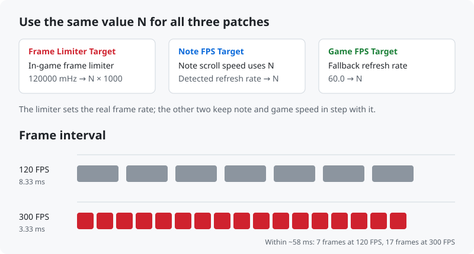
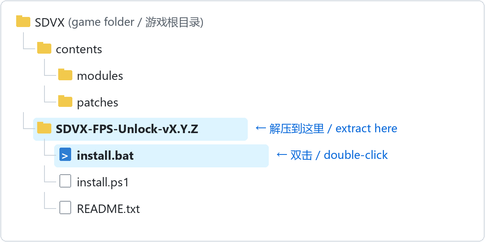
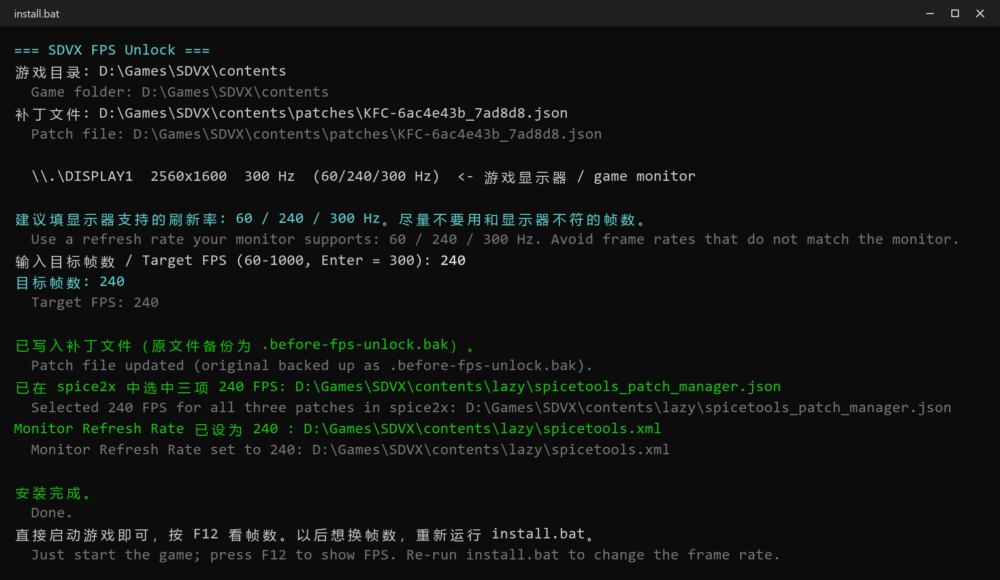
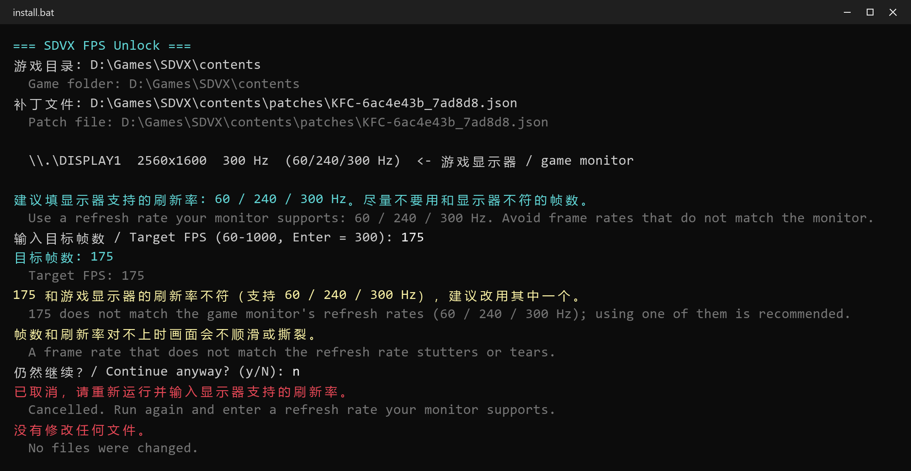
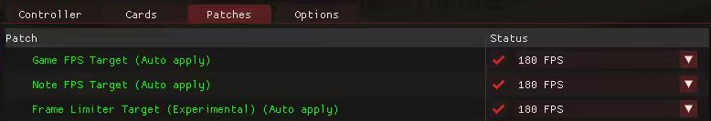
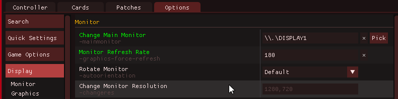

# SDVX FPS Unlock

**Lift the internal 120 FPS cap of SOUND VOLTEX on spice2x — any target frame rate (60–1000 FPS)**

   

[简体中文](README.md) · **English**

> [!WARNING]
> **Experimental.** Parts of the game are hard-coded for 120 FPS, so some animations may run faster than normal. If gameplay feels off, switch back to 120.

> [!IMPORTANT]
> **Use a refresh rate your monitor supports as the target FPS** (the installer lists them). A mismatch stutters or tears, and on portrait monitors Live2D character animations also run too fast or slow.

  

## Contents

- [Features](#features)
- [Requirements](#requirements)
- [Quick start](#quick-start)
- [Tested versions](#tested-versions)
- [Troubleshooting](#troubleshooting)
- [Uninstall](#uninstall)
- [How it works](#how-it-works)
- [Disclaimer](#disclaimer)
- [Acknowledgements](#acknowledgements)
- [License](#license)

## Features

- **Removes the real cap** — patches the game's internal frame limiter, not just the reported refresh rate.
- **Any frame rate** — type your target FPS during install (defaults to your monitor's highest refresh rate); not limited to presets, with a warning if your monitor does not support it.
- **One-step setup** — selects all three patches in spice2x for you, and sets Monitor Refresh Rate on portrait monitors.
- **Matching speed patches** — *Game FPS Target*, *Note FPS Target* and the limiter use the same value so note speed stays correct.
- **No game files modified** — everything is a spice2x patch applied in memory at launch.
- **Version-aware installer** — finds the right patch file from the game's DLL, verifies every byte it relies on and locates the limiter by signature. Any mismatch aborts without touching a file.
- **Safe to re-run** — backs up the original patch file once; running again gives the same result.

## Requirements

- Windows 10 / 11 (uses the built-in Windows PowerShell 5.1)
- SOUND VOLTEX (`KFC`) launched with **spice2x**, with its patch files in `contents\patches\`

## Quick start

1. **Close the game.**
2. Download `SDVX-FPS-Unlock-*.zip` from [Releases](https://github.com/xiaoming6680/SDVX-FPS-Unlock/releases/latest), extract it into the game folder (the one containing `contents`) and run **`install.bat`**.
   If it is placed elsewhere, the installer asks for the game path.

   

3. The installer lists your monitors and their refresh rates. **Type a target FPS** and press Enter (Enter alone uses the monitor's highest refresh rate).
   **Pick one of the refresh rates the installer lists; avoid frame rates that do not match your monitor.** A mismatch stutters or tears; on portrait monitors (1080×1920) V-Sync sets the frame rate while Live2D character animations are timed by this value, so they also run too fast or slow. The installer warns and asks you to confirm if the value is unsupported.

   

   Entering a rate the monitor does not support (for example 175 on a 300 Hz monitor):

   

4. The installer then:
   - generates the options for all three patches (including your value) and selects them in spice2x
   - on portrait monitors, sets **Monitor Refresh Rate** to the same value (otherwise the game switches to 120 Hz with V-Sync and stays at 120 FPS)
5. Start the game and press **F12** to show the FPS counter.

Re-run `install.bat` to change the frame rate, and after every game update.

If the installer says to select the patches manually

The spice2x settings file does not exist until the game has been launched once. Launch the game once and re-run the installer, or set it up by hand:

1. **F4 → Patches**: set Game FPS Target, Note FPS Target and Frame Limiter Target (Experimental) to the same value, click **Save** and restart.

   

2. Portrait only: set **F4 → Options → Display → Monitor → Monitor Refresh Rate** to the same value and restart.

   

## Tested versions

| Game version | Monitor | Result |
|---|---|---|
| `KFC:J:G:A:2026101300` | 2560×1600 · 300 Hz | ✅ 300 FPS |
| `KFC:J:G:A:2026071400` | 1080×1920 · 180 Hz | ✅ 180 FPS (Monitor Refresh Rate = 180) |

Tested it on another version? Please submit a [version test report](https://github.com/xiaoming6680/SDVX-FPS-Unlock/issues/new?template=1-compatibility.yml).

## Troubleshooting

<b>Still 120 FPS</b>

- Fully restart the game after saving the patches — the limiter is read only at startup.
- Portrait monitor: Monitor Refresh Rate is not set; re-run the installer or follow the manual steps in [Quick start](#quick-start).
- V-Sync forced in the GPU driver: set it back to *Use the 3D application setting* in the NVIDIA Control Panel.

<b>Game freezes on the attract video</b>

- Free up GPU memory (close model training or other GPU-heavy apps).
- Quit virtual display software such as NetEase GameViewer; extra displays confuse refresh rate detection.
- Make sure the three patches and Monitor Refresh Rate use the same value.

<b>Screen stops updating after Alt-Tab</b>

Enable **F4 → Options → Windowed** and keep the SDVX subscreen redraw option on.

<b>Animations or notes feel too fast</b>

- Make sure the three patches use the same value (the installer selects them; changing one later in F4 can break this).
- Check that the target FPS is a refresh rate your monitor supports; if not, re-run the installer and enter one of the listed rates.
- Portrait monitor: Monitor Refresh Rate must be that same value and equal to the monitor's real refresh rate. For a 180 Hz monitor, enter 180, not 300.
- Still wrong: parts of the game are hard-coded for 120 FPS; set all three patches back to 120 FPS.

## Uninstall

Re-run the installer and enter 120, or set all three patches back to **120 FPS** in F4 → Patches. On portrait monitors, set Monitor Refresh Rate back to its old value.
To restore everything, rename the installer's `*.before-fps-unlock.bak` backups back over the originals: the patch file in `contents\patches\`, and spice2x's patch settings and `spicetools.xml` (paths are shown during install).

## How it works

The game paces frames with an internal limiter initialised to 120 000 mHz (`mov ebx, 120000`). The installer locates that instruction by signature and adds a patch that replaces the constant; the two existing FPS patches are widened so the game computes note and frame timing at the same rate.

Full reverse-engineering notes (Chinese): [docs/逆向记录.md](docs/逆向记录.md)

## Disclaimer

- This project is **not affiliated with, endorsed by, or connected to KONAMI** in any way. SOUND VOLTEX, e-amusement and related names are trademarks of their respective owners.
- This repository **contains no game files, executables or assets**, and does not explain how to obtain them.
- It is provided for **personal, educational and interoperability research** use with software you are legally entitled to use. You are responsible for complying with the laws of your jurisdiction and any applicable terms.
- **Do not use it with official online services** or in any competitive or ranked environment.
- The software is provided **"as is", without warranty of any kind**. The authors are not liable for any damage, data loss, account action or other consequences of using it.
- Rights holders with concerns are welcome to [open an issue](https://github.com/xiaoming6680/SDVX-FPS-Unlock/issues/new?template=4-other.yml); it will be addressed promptly.

## Acknowledgements

- [spice2x](https://spice2x.github.io/) — the loader and patch manager this builds on
- The community patch authors behind the original *Game FPS Target* / *Note FPS Target* patches

## License

[MIT](LICENSE)
