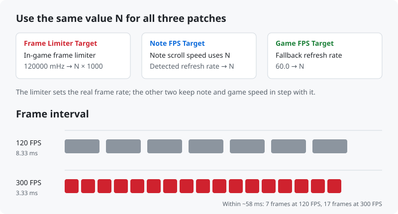

# SDVX FPS Unlock

**Lift the internal 120 FPS cap of SOUND VOLTEX on spice2x — 144 / 165 / 180 / 185 / 240 / 300 FPS**

   

**English** · [简体中文](README.zh-CN.md)

> [!WARNING]
> **Experimental.** Parts of the game are hard-coded for 120 FPS, so some animations may run faster than normal. If gameplay feels off, switch back to 120.

  

## Contents

- [Features](#features)
- [Requirements](#requirements)
- [Quick start](#quick-start)
- [Tested versions](#tested-versions)
- [Troubleshooting](#troubleshooting)
- [Uninstall](#uninstall)
- [How it works](#how-it-works)
- [Disclaimer](#disclaimer)
- [Acknowledgements](#acknowledgements)
- [License](#license)

## Features

- **Removes the real cap** — patches the game's internal frame limiter, not just the reported refresh rate.
- **Matching speed patches** — extends *Game FPS Target* and *Note FPS Target* with the same frame rates so note speed stays correct.
- **No game files modified** — everything is a spice2x patch applied in memory at launch.
- **Version-aware installer** — finds the right patch file from the game's DLL, verifies every byte it relies on and locates the limiter by signature. Any mismatch aborts without touching a file.
- **Safe to re-run** — backs up the original patch file once; running again gives the same result.

## Requirements

- Windows 10 / 11 (uses the built-in Windows PowerShell 5.1)
- SOUND VOLTEX (`KFC`) launched with **spice2x**, with its patch files in `contents\patches\`

## Quick start

1. **Close the game.**
2. Download `SDVX-FPS-Unlock-*.zip` from [Releases](https://github.com/xiaoming6680/SDVX-FPS-Unlock/releases/latest), extract it into the game folder (the one containing `contents`) and run **`install.bat`**.
   If it is placed elsewhere, the installer asks for the game path.
3. Start the game, press **F4 → Patches**, set these three to the **same value** (ideally your monitor's refresh rate), click **Save** and restart the game:
   - Game FPS Target
   - Note FPS Target
   - Frame Limiter Target (Experimental)

   

4. **Portrait monitors (1080×1920) only:** set **F4 → Options → Display → Monitor → Monitor Refresh Rate** to the same value and restart.
   Otherwise the game switches the monitor to 120 Hz with V-Sync and stays at 120 FPS.

   

Press **F12** in game to show the FPS counter. Re-run `install.bat` after updating the game.

## Tested versions

| Game version | Monitor | Result |
|---|---|---|
| `KFC:J:G:A:2026101300` | 2560×1600 · 300 Hz | ✅ 300 FPS |
| `KFC:J:G:A:2026071400` | 1080×1920 · 180 Hz | ✅ 180 FPS (Monitor Refresh Rate = 180) |

Tested it on another version? Please open an issue with the result.

## Troubleshooting

<b>Still 120 FPS</b>

- Fully restart the game after saving the patches — the limiter is read only at startup.
- Portrait monitor: do step 4 of [Quick start](#quick-start).
- V-Sync forced in the GPU driver: set it back to *Use the 3D application setting* in the NVIDIA Control Panel.

<b>Game freezes on the attract video</b>

- Free up GPU memory (close model training or other GPU-heavy apps).
- Quit virtual display software such as NetEase GameViewer; extra displays confuse refresh rate detection.
- Make sure the three patches and Monitor Refresh Rate use the same value.

<b>Screen stops updating after Alt-Tab</b>

Enable **F4 → Options → Windowed** and keep the SDVX subscreen redraw option on.

<b>Animations or notes feel too fast</b>

This is the experimental part. Set all three patches back to 120 FPS.

## Uninstall

Set all three patches back to **120 FPS** in F4 → Patches.
To restore the original patch file, rename `contents\patches\*.before-fps-unlock.bak` back to the matching `.json`.

## How it works

The game paces frames with an internal limiter initialised to 120 000 mHz (`mov ebx, 120000`). The installer locates that instruction by signature and adds a patch that replaces the constant; the two existing FPS patches are widened so the game computes note and frame timing at the same rate.

Full reverse-engineering notes (Chinese): [docs/逆向记录.md](docs/逆向记录.md)

## Disclaimer

- This project is **not affiliated with, endorsed by, or connected to KONAMI** in any way. SOUND VOLTEX, e-amusement and related names are trademarks of their respective owners.
- This repository **contains no game files, executables or assets**, and does not explain how to obtain them.
- It is provided for **personal, educational and interoperability research** use with software you are legally entitled to use. You are responsible for complying with the laws of your jurisdiction and any applicable terms.
- **Do not use it with official online services** or in any competitive or ranked environment.
- The software is provided **"as is", without warranty of any kind**. The authors are not liable for any damage, data loss, account action or other consequences of using it.
- Rights holders with concerns are welcome to [open an issue](https://github.com/xiaoming6680/SDVX-FPS-Unlock/issues); it will be addressed promptly.

## Acknowledgements

- [spice2x](https://spice2x.github.io/) — the loader and patch manager this builds on
- The community patch authors behind the original *Game FPS Target* / *Note FPS Target* patches

## License

[MIT](LICENSE)
