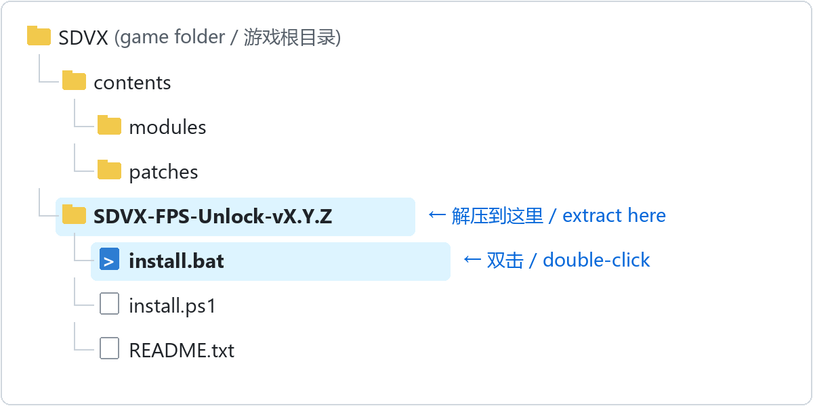
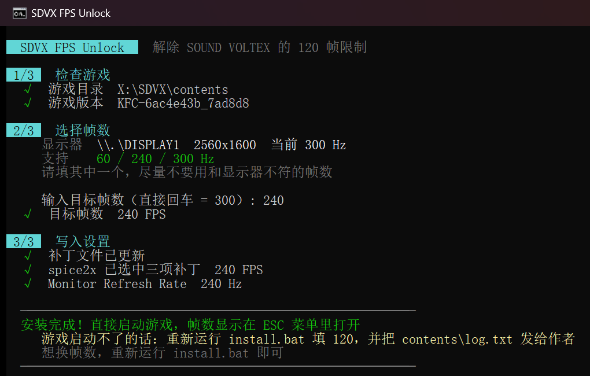
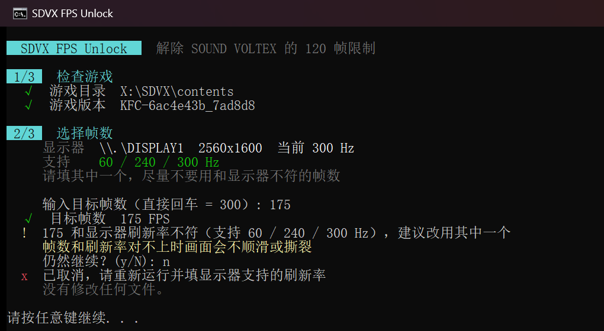
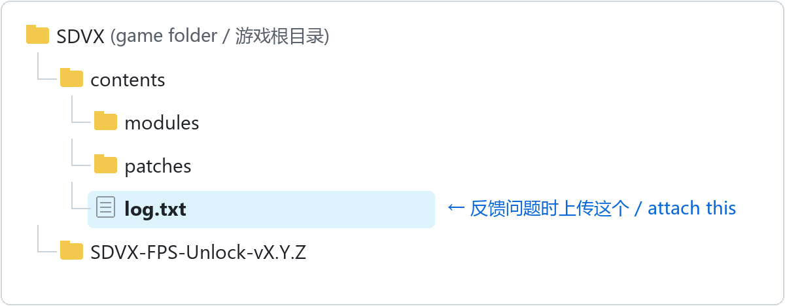

# SDVX FPS Unlock

**让 SOUND VOLTEX 在 spice2x 下突破 120 帧** 
144 / 165 / 180 / 240 / 300Hz……什么刷新率的屏幕都能用

### [⬇ 下载最新版](https://github.com/xiaoming6680/SDVX-FPS-Unlock/releases/latest)

在打开的页面最下面 **Assets** 里点 `SDVX-FPS-Unlock-v….zip`

**简体中文** · [English](README.en.md)

## 使用方法

**1. 关闭游戏，把下载的 zip 解压到游戏根目录**（有 `contents` 文件夹的那一层），双击里面的 **`install.bat`**

**2. 输入你的显示器刷新率，回车**（直接回车 = 自动检测到的最高刷新率）

安装器会自动在 spice2x 里选好补丁，竖屏显示器还会设好 Monitor Refresh Rate。

填了显示器不支持的数，安装器会提醒，可以取消重填：

**3. 照常启动游戏**，帧数显示在 ESC 菜单里打开

想换帧数、或者游戏更新了，重新运行一次 `install.bat` 就行。

> [!IMPORTANT]
> - **填显示器支持的刷新率**（安装器会列出来，比如 144 的屏就填 144）。不符时画面会不顺滑；竖屏显示器上 Live2D 角色动画还会变快或变慢。
> - 实验性功能：游戏少数地方按 120 帧写死，感觉不对就重新运行安装器填 120。

## 遇到问题

先看下面的常见问题。解决不了就[提交问题](https://github.com/xiaoming6680/SDVX-FPS-Unlock/issues/new?template=2-bug.yml)，**一定要附上日志文件 `contents\log.txt`**：出问题后关掉游戏，把它拖进 issue 里上传。上传前用记事本删掉卡号（`-card0` 那几行）、PCBID 等个人信息。没有日志基本没法排查。

## 常见问题

<b>帧数还是 120</b>

- 改完要完全重启游戏。
- 竖屏显示器：安装器提示「不会设置 Monitor Refresh Rate」时，说明这块屏在游戏全屏的 1080×1920 下没有这个刷新率，只能选安装器列出的数。
- 显卡驱动强制开了垂直同步：NVIDIA 控制面板里改回「使用 3D 应用程序设置」。

<b>改了帧数后游戏启动不了</b>

重新运行 `install.bat` 填 120（或在启动器 / F4 里把 Monitor Refresh Rate 改回 120）就能进游戏。然后[提交 Bug](https://github.com/xiaoming6680/SDVX-FPS-Unlock/issues/new?template=2-bug.yml) 并附上启动失败后的 `contents\log.txt`（先删掉卡号等个人信息）。

<b>动画或音符变快</b>

- 填的数要等于显示器刷新率，重新运行安装器改一下。
- 装完之后在 F4 → Patches 里改过的话，三项补丁要选同一个数。
- 仍然不对就填 120。

<b>安装器提示「需要手动选择」</b>

游戏还没用 spice2x 启动过。先启动一次游戏再运行安装器，或者手动设置：**F4 → Patches** 把 Game FPS Target、Note FPS Target、Frame Limiter Target (Experimental) 选成同一个数，点 **Save**，重启游戏。竖屏显示器还要在 **F4 → Options → Display → Monitor → Monitor Refresh Rate** 填同一个数。

<b>游戏卡在待机视频不动</b>

- 释放显存（关掉占显卡的程序）。
- 退出网易 GameViewer 等虚拟显示器软件。

<b>切到后台再切回来画面不刷新</b>

打开 **F4 → Options → Windowed**（窗口模式），并保持 SDVX 副屏重绘（subscreen redraw）开启。

<b>怎么卸载</b>

重新运行 `install.bat` 填 120 即可。要完全还原，把安装器留下的 `*.before-fps-unlock.bak` 改名覆盖回原文件（安装时会显示路径）。

## 已测试

| 游戏版本 | 显示器 | 结果 |
|---|---|---|
| `KFC:J:G:A:2026101300` | 2560×1600 · 300Hz | ✅ 300 FPS |
| `KFC:J:G:A:2026071400` | 1080×1920 · 180Hz | ✅ 180 FPS |

测过别的版本？欢迎提交[版本测试报告](https://github.com/xiaoming6680/SDVX-FPS-Unlock/issues/new?template=1-compatibility.yml)。原理见 [docs/逆向记录.md](docs/逆向记录.md)。

## 免责声明

本项目与 KONAMI 无关，不包含任何游戏文件，仅供个人学习研究，请勿用于官方联网服务；按原样提供，不附带任何担保，使用后果自负。权利人如有疑虑请[提交 issue](https://github.com/xiaoming6680/SDVX-FPS-Unlock/issues/new?template=4-other.yml)。

感谢 [spice2x](https://spice2x.github.io/) 和原版 FPS 补丁的社区作者们。许可证：[MIT](LICENSE)
