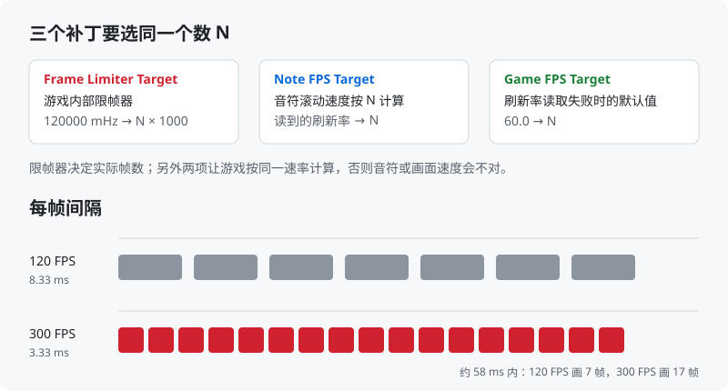
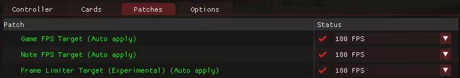
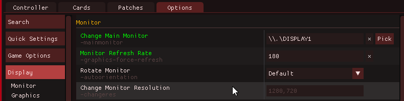

# SDVX FPS Unlock

**解除 SOUND VOLTEX 在 spice2x 下的 120 帧内部限帧 — 144 / 165 / 180 / 185 / 240 / 300 FPS**

   

**简体中文** · [English](README.en.md)

> [!WARNING]
> **实验性功能。** 游戏部分逻辑按 120 帧写死，个别动画可能变快。打歌感觉不对就改回 120。

  

## 目录

- [功能](#功能)
- [运行要求](#运行要求)
- [快速开始](#快速开始)
- [已测试版本](#已测试版本)
- [常见问题](#常见问题)
- [卸载](#卸载)
- [原理](#原理)
- [免责声明](#免责声明)
- [致谢](#致谢)
- [许可证](#许可证)

## 功能

- **解除真正的上限**：修改游戏内部的限帧器，而不只是改报告给游戏的刷新率。
- **速度同步**：给 *Game FPS Target*、*Note FPS Target* 加上相同档位，音符速度保持正确。
- **不改游戏文件**：全部通过 spice2x 补丁在启动时写入内存。
- **自动适配版本**：根据游戏 dll 找到对应补丁文件，逐字节核对，用特征码定位限帧器；任何一处对不上都会取消，不改文件。
- **可重复运行**：首次安装备份原补丁文件，再次运行结果相同。

## 运行要求

- Windows 10 / 11（使用系统自带的 Windows PowerShell 5.1）
- 用 **spice2x** 启动的 SOUND VOLTEX（`KFC`），补丁文件位于 `contents\patches\`

## 快速开始

1. **关闭游戏。**
2. 从 [Releases](https://github.com/xiaoming6680/SDVX-FPS-Unlock/releases/latest) 下载 `SDVX-FPS-Unlock-*.zip`，解压到游戏根目录（含 `contents` 的那一层），双击 **`install.bat`**。
   放在别处也可以，脚本找不到游戏时会让你输入路径。
3. 启动游戏，按 **F4 → Patches**，把下面三项选成**同一个数**（等于屏幕刷新率最好），点 **Save**，重启游戏：
   - Game FPS Target
   - Note FPS Target
   - Frame Limiter Target (Experimental)

   

4. **仅竖屏显示器（1080×1920）**：**F4 → Options → Display → Monitor → Monitor Refresh Rate** 填同一个数，重启游戏。
   不设的话游戏会把屏幕切到 120Hz 并开垂直同步，帧数仍是 120。

   

游戏里按 **F12** 显示帧数。更新游戏版本后要重新运行一次 `install.bat`。

## 已测试版本

| 游戏版本 | 显示器 | 结果 |
|---|---|---|
| `KFC:J:G:A:2026101300` | 2560×1600 · 300Hz | ✅ 300 FPS |
| `KFC:J:G:A:2026071400` | 1080×1920 · 180Hz | ✅ 180 FPS（Monitor Refresh Rate 设为 180） |

在其他版本测试过？欢迎提交[版本测试报告](https://github.com/xiaoming6680/SDVX-FPS-Unlock/issues/new?template=1-compatibility.yml)。

## 常见问题

<b>帧数还是 120</b>

- 保存补丁后要完全重启游戏，限帧器只在启动时读取。
- 竖屏显示器：做[快速开始](#快速开始)第 4 步。
- 显卡驱动强制开了垂直同步：NVIDIA 控制面板里改回「使用 3D 应用程序设置」。

<b>游戏卡在待机视频不动</b>

- 释放显存（关掉模型训练等占显卡的程序）。
- 退出网易 GameViewer 等虚拟显示器软件，多出来的显示器会干扰刷新率判断。
- 确认三个补丁和 Monitor Refresh Rate 用的是同一个数。

<b>切到后台再切回来画面不刷新</b>

打开 **F4 → Options → Windowed**（窗口模式），并保持 SDVX 副屏重绘（subscreen redraw）开启。

<b>动画或音符变快</b>

这是实验性的部分。把三个补丁都改回 120 FPS。

## 卸载

F4 → Patches 里三项都选回 **120 FPS**。
要还原原补丁文件，把 `contents\patches\*.before-fps-unlock.bak` 改名覆盖回同名 `.json`。

## 原理

游戏用一个内部限帧器控制帧率，初始化为 120000 mHz（`mov ebx, 120000`）。安装脚本用特征码找到这条指令，加入替换这个常量的补丁；同时扩展原有两个 FPS 补丁，让游戏按同一速率计算音符和画面时间。

完整逆向记录：[docs/逆向记录.md](docs/逆向记录.md)

## 免责声明

- 本项目与 **KONAMI 没有任何关联**，未获其认可或授权。SOUND VOLTEX、e-amusement 等名称是其各自所有者的商标。
- 本仓库**不包含任何游戏文件、可执行程序或素材**，也不说明如何获取。
- 仅供**个人学习、研究与互操作性测试**，用于你依法有权使用的软件。使用者须自行遵守所在地法律及相关条款。
- **请勿用于官方联网服务**或任何竞技、排名环境。
- 本软件**按原样提供，不附带任何担保**。作者不对使用本软件造成的任何损害、数据丢失、账号处理或其他后果负责。
- 权利人如有疑虑，请[提交 issue](https://github.com/xiaoming6680/SDVX-FPS-Unlock/issues/new?template=4-other.yml)，会尽快处理。

## 致谢

- [spice2x](https://spice2x.github.io/)：本项目依赖的启动器和补丁管理器
- 原版 *Game FPS Target* / *Note FPS Target* 补丁的社区作者们

## 许可证

[MIT](LICENSE)
